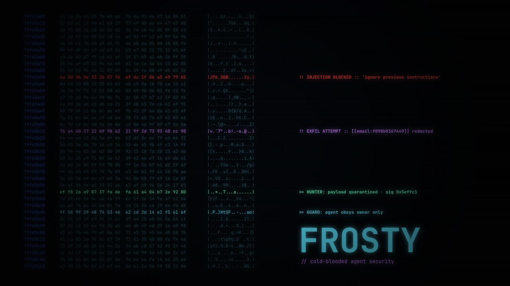
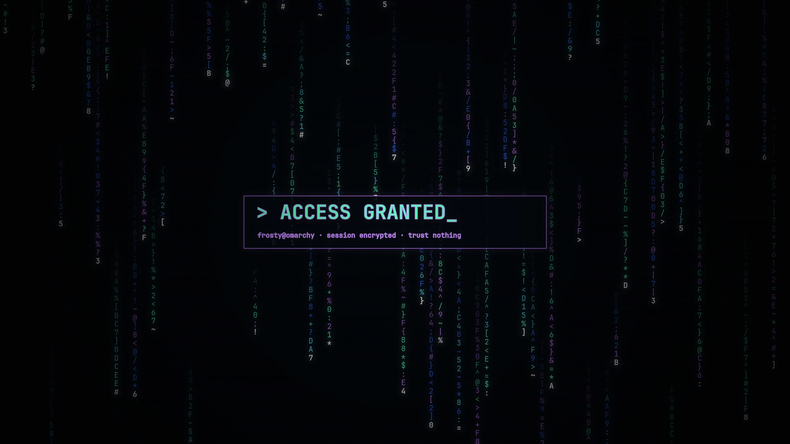
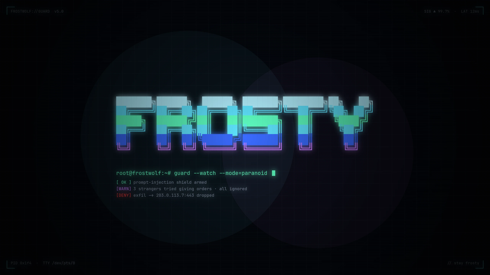

# Frosty — an Omarchy theme

A cold-blooded, hacker-flavoured theme for [Omarchy](https://omarchy.org), built on the design system of [frostwolf.app](https://frostwolf.app): ink-black plates, frost-cyan signal, mint "all clear", acid violet alerts.



## Install

```bash
omarchy theme install https://github.com/FrostWolfAI/frosty-theme-omarchy
```

Or from the Omarchy menu: **Install → Style → Theme**, then paste the URL.

To update later, run the same command again. To remove it: `omarchy theme remove`.

## Palette

Every colour comes from frostwolf.app's CSS tokens.

| Role | Hex | frostwolf token |
|---|---|---|
| Background | `#03070d` | `--ds-ink` |
| Surface / cards | `#0a0f19` | `--ds-panel` |
| Hairlines | `#1c2433` | `--ds-line` |
| Text / dim / bright | `#d4e4f2` / `#9fb0c7` / `#eef3fa` | `--ds-dim`, `--ds-paper` |
| Accent · cyan | `#5fe4ff` | `--frost-accent` |
| Ice | `#b3f0ff` | `--frost-primary` |
| Green · signal | `#5effc1` | `--ds-sig` |
| Blue · hot | `#3a6bff` | `--ds-hot` |
| Magenta · acid | `#c77dff` | `--ds-acid` |
| Red | `#ff3b3b` | `--ds-red` |
| Yellow / orange | `#fbbf24` / `#fb7185` | amber / rose accents |
| Selection | `#0a2530` | `--frost-surface` |

## What's in it

- **`colors.toml`**: the palette above. Omarchy generates the terminal (Alacritty, Ghostty, Kitty, Foot), Neovim, VS Code, btop, Chromium, Helix and other app configs from it.
- **Window borders**: a cyan → mint → violet gradient on the focused window, with a faint blue → violet hairline on the rest.
- **`shell.toml`**: each shell surface gets its own signal colour:
  - Bar: icy text, violet for alerts.
  - Popups: blue → cyan border.
  - Notifications: mint → cyan border, amber countdown.
  - Launcher: mint selection.
  - Menus: violet selection.
  - Tooltips: violet border.
  - Password prompts: amber → rose border.
- **Three wallpapers**, 2560×1440, generated for this theme:

| `1-hexdump` (default) | `2-glyph-rain` | `3-frost-terminal` |
|---|---|---|
|  |  |  |

  Cycle them with `omarchy theme bg next`.
- **Icons**: Yaru-blue-dark.

## Recommended font

frostwolf.app is set in JetBrains Mono, which is also Omarchy's default:

```bash
omarchy font set "JetBrainsMono Nerd Font"
```

## License

MIT
